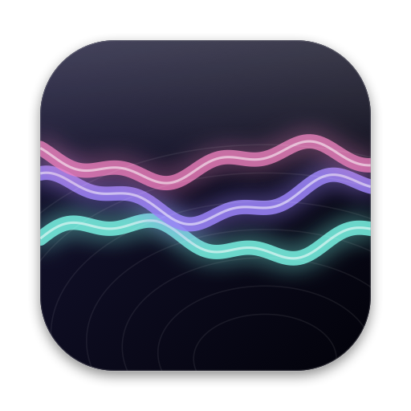
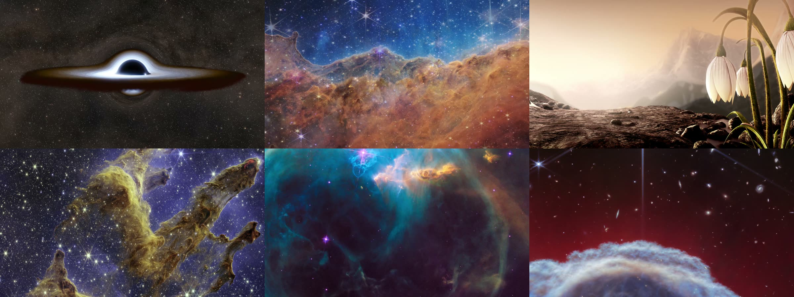

<div align="center">
  
  <h1>Driftwall</h1>
  <p><b>Live 4K wallpapers for your Mac desktop</b></p>

  [](https://github.com/shorielol/driftwall/releases/latest)
  
  [](LICENSE)
</div>

<br>



Driftwall plays looping video behind your desktop icons, on every display and every Space. The catalog is a hand-cut set of seamless loops: deep-space pans from the Webb and Hubble telescopes, NASA's black hole simulations, and scenes from Blender's open movies. Eight more wallpapers are drawn live by the app itself. A new batch arrives every three weeks.

## Install

Download `Driftwall.zip` from the [latest release](https://github.com/shorielol/driftwall/releases/latest), unzip it and move Driftwall to your Applications folder.

The app isn't notarized yet, so macOS will stop it the first time. Open **System Settings → Privacy & Security**, scroll down and click **Open Anyway**. If you'd rather use Terminal:

```sh
xattr -dr com.apple.quarantine /Applications/Driftwall.app
```

Driftwall needs macOS 15 Sequoia or later. On macOS 26 the interface uses Liquid Glass.

## Features

- Wallpapers play under your icons on every display, and each monitor remembers its own wallpaper when you plug it back in.
- Most of the catalog is 3840×2160. Nothing goes below 1080p, and nothing is upscaled to pass that bar.
- Hover a card to stream a preview. Setting a wallpaper downloads the full file once, so it plays offline afterwards.
- Playback pauses on its own when an app goes full screen on that display, in Low Power Mode, below 20% battery, and while the screen is locked.
- Playlists rotate your favourites on a timer. You can also pair one wallpaper for day and another for night, or follow light and dark mode.
- Drag any MP4, MOV or M4V onto the window to use your own video. Driftwall can also watch your Downloads folder and offer new videos as they arrive. Imports never leave your Mac.
- If you used Wallspace before, Library → Imported picks up the videos you already downloaded with it.
- The menu bar item pauses playback, skips ahead and shows what's on each display.
- No accounts and no analytics. The only network requests fetch the catalog, the posters and the videos you choose.

## The wallpapers

| Collection | Source | Licence |
| --- | --- | --- |
| Space | ESA/Webb and ESA/Hubble pans and zooms | CC BY 4.0 |
| Black holes | NASA Goddard Scientific Visualization Studio | Public domain |
| Fantasy, Sci-fi, Animated | *Sintel*, *Charge*, *Tears of Steel* and *Big Buck Bunny* by the Blender Foundation | CC BY 3.0 / 4.0 |
| Originals | Shaders written for Driftwall (ink wash, papercraft, stained glass, risograph, oil paint, Bauhaus, liquid chrome, dithered CRT) | MIT |

Each loop is cut by hand from its source. Slow camera moves play forward and then back, and ambient shots dissolve their last second into their first, so neither kind jumps when it repeats. The film scenes are cropped to 16:9 from 4K scope masters, which leaves them between 2858×1608 and 3100×1744.

Everything in the catalog may legally be redistributed, and every wallpaper credits its source in the app. Stock-footage sites such as Pexels and Mixkit forbid use in wallpaper apps, and fan art of anime or game characters belongs to the studios, so neither appears here. You can still import your own clips.

The reasoning behind the catalog, with the data, is in [docs/CONTENT_RESEARCH.md](docs/CONTENT_RESEARCH.md).

## FAQ

**Can it animate the lock screen?**
Not yet. macOS has no public API for an animated lock screen, and the apps that manage it load a private Apple framework. Driftwall sets a still frame from your wallpaper instead, so the lock screen and Mission Control match.

**How much battery does it use?**
Playback is hardware-decoded and stops whenever an auto-pause rule applies. If you want to be strict, turn on "Whenever running on battery" in Settings.

**Where are downloaded wallpapers kept?**
In `~/Library/Caches/Driftwall/Wallpapers`, capped at a size you choose in Settings. Your own imports live in `~/Library/Application Support/Driftwall`.

## Building from source

You need Xcode 26 or later and [XcodeGen](https://github.com/yonaskolb/XcodeGen).

```sh
brew install xcodegen
git clone https://github.com/shorielol/driftwall.git
cd driftwall
make run     # generates the Xcode project, builds Release and opens the app
make test    # Swift package tests and catalog tool tests
```

The testable logic lives in `Packages/DriftwallCore`: catalog validation, search, playlists, scheduling, auto-pause rules, the video cache and catalog refresh.

### How the catalog is built

Shots are described in `tools/loops/manifests/`, one file per source video, with credit, licence and cut points. `make loops` uses ffmpeg to crop each shot, make it loop and encode a 4K HEVC master, a 720p preview and a poster. The files go up as a GitHub release, and the entries land in `catalog/loops.json`.

A scheduled workflow (`.github/workflows/catalog-drop.yml`) publishes the next loops from that backlog every third Monday, rotates the featured row, checks every link, and deploys `catalog.json` to GitHub Pages. The app ships the latest catalog as an offline copy and refreshes it daily.

`make discover` lists new 4K pans from ESA/Webb and ESA/Hubble that no manifest uses yet. Someone still has to watch them and pick the good ones.

```
App/Driftwall/            SwiftUI and AppKit app
Packages/DriftwallCore/   testable logic (Swift Testing)
tools/loops/              loop renderer and shot manifests
tools/scraper/            drop builder, link checker, discovery (Python)
catalog/                  published catalog and drop history
```

## Credits

Space videos: ESA/Webb, NASA & CSA, and ESA/Hubble & NASA, under [CC BY 4.0](https://creativecommons.org/licenses/by/4.0/). Black hole visualizations: NASA's Goddard Space Flight Center, Jeremy Schnittman. NASA doesn't endorse this project. Film scenes: © Blender Foundation, [studio.blender.org](https://studio.blender.org), under CC BY 3.0 (*Sintel*, *Tears of Steel*, *Big Buck Bunny*) and CC BY 4.0 (*Charge*). Loops are cropped, trimmed and re-encoded, and audio is removed.

## License

The code is MIT licensed, see [LICENSE](LICENSE). The videos keep their own licences, listed above.

Made by Shaurya ([@shorielol](https://github.com/shorielol)).
